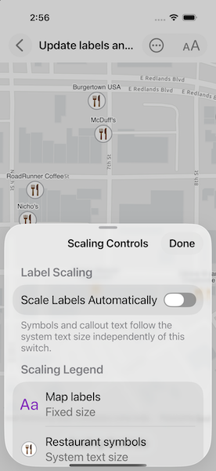

# Update labels and symbols to scale for visual accessibility

Scale feature labels and symbols according to the system text-size setting.

## Use case

Improve map readability for users who increase text size in accessibility settings. Use SwiftUI Dynamic Type to scale restaurant labels and symbols, with independent control over label scaling.

## How to use the sample

Use **Text Size Help** in the toolbar for instructions and an **Open Accessibility Settings** action. On iOS, the action opens a page within **Accessibility** settings (**AssistiveTouch** > **Devices** on iOS 26, **Personal Voice** on iOS 18); navigate back to **Accessibility**, then select **Display & Text Size** > **Larger Text**. No changes are needed on the opened page. Enable **Larger Accessibility Sizes** for additional sizes, then return to the sample. On Mac Catalyst, navigate to **Accessibility** > **Display** > **Text size**; support depends on the system and app settings. A tip also appears above the map when space and text size permit.

Turn off **Scale Labels** below the map to restore labels to their base size. Symbols continue to follow Dynamic Type. The toggle stays pinned at the bottom. The legend remains available above it at all text sizes, including accessibility sizes and compact-height layouts, and scrolls independently when needed. It shows the current scale and the symbol-size calculation, for example, **Symbols: Dynamic Type — 24 pt × 100% = 24 pt**. **Text Size Help** provides instructions and an action to open settings. Select a restaurant to show its name and WGS 84 coordinates. Select elsewhere to clear the selection and callout.

## How it works

1. Create a `Map` and a `FeatureLayer` for the restaurants.
2. Add a `LabelDefinition` with an `ArcadeLabelExpression` for the name and a `TextSymbol`, enable labels, and use dynamic deconfliction to move or omit overlapping labels.
3. In a view-lifetime task, load the layer and a `SymbolStyle` created with `styleName: "Esri2DPointSymbolsStyle"` and an anonymous ArcGIS Online portal. Await `symbol(forKeys: ["restaurant"])`, check that it is a `MultilayerPointSymbol`, and apply it with a `SimpleRenderer` before adding the layer to the map. Show loading progress and report failures with an error alert; cancellation does not show an alert.
4. Use `@ScaledMetric(relativeTo: .body)` to obtain a Dynamic Type scale factor. Observe changes with `onChange(of:initial:_:)`, including the initial value.
5. Set `MultilayerPointSymbol.size` to the marker's base size multiplied by the latest scale factor, including when loading finishes after a text-size change. Scale the label's text symbol only when the label-scaling toggle is enabled. Store these settings in an `@Observable` model. Create a fixed-size legend swatch with `Symbol.makeSwatch(scale:size:backgroundColor:)` from a clone so the legend does not alter the map symbol.
6. Identify a restaurant with `MapViewProxy.identify(on:screenPoint:tolerance:returnPopupsOnly:maximumResults:)`, and select the feature.
7. Project its location to WGS 84 with `GeometryEngine.project(_:into:)` and show its name and coordinates in a callout. Use semantic fonts so callout text responds to Dynamic Type independently of the label toggle.

## Relevant API

* View.dynamicTypeSize(_:)

## About the data

This sample uses a [Redlands restaurants](https://www.arcgis.com/home/item.html?id=46119989eccd46a58b8f3d7aedadeb90) feature layer covering food establishments in Redlands, California. Each feature represents a single restaurant.

The `restaurant` symbol is provided by Esri's [Esri2DPointSymbols web style](https://www.arcgis.com/home/item.html?id=220936cc6ed342c9937abd8f180e7d1e), accessed through `Esri2DPointSymbolsStyle`. Internet access is required to load the public style and restaurant layer. The basemap uses the host app's configured API key.

## Additional information

SwiftUI Dynamic Type scales restaurant symbols and, when **Scale Labels** is enabled, restaurant labels; basemap labels are unaffected. Sizes are recalculated from their base values to avoid cumulative scaling.

## Tags

accessibility, dynamic type, label, readability, scale, symbol, text, visual impairment
